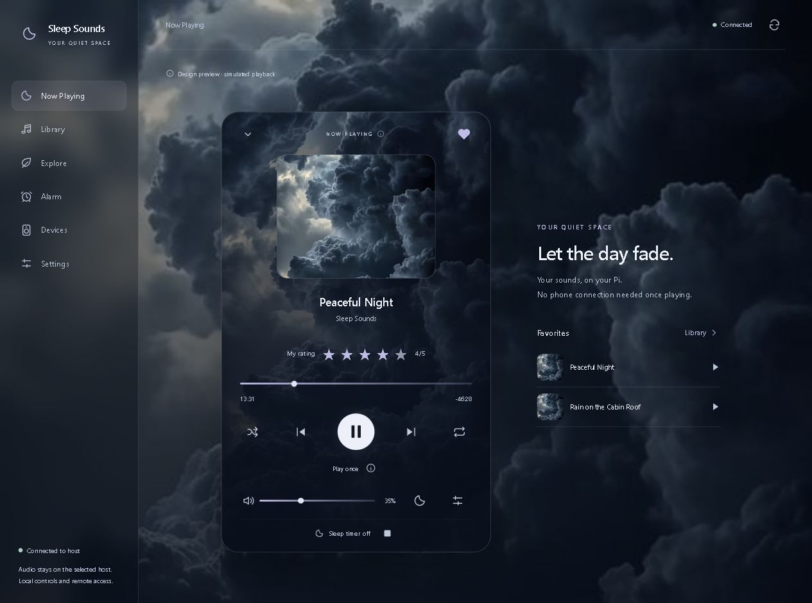
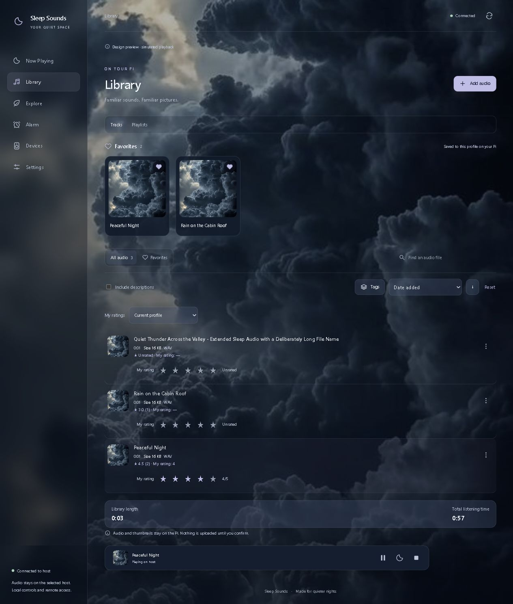
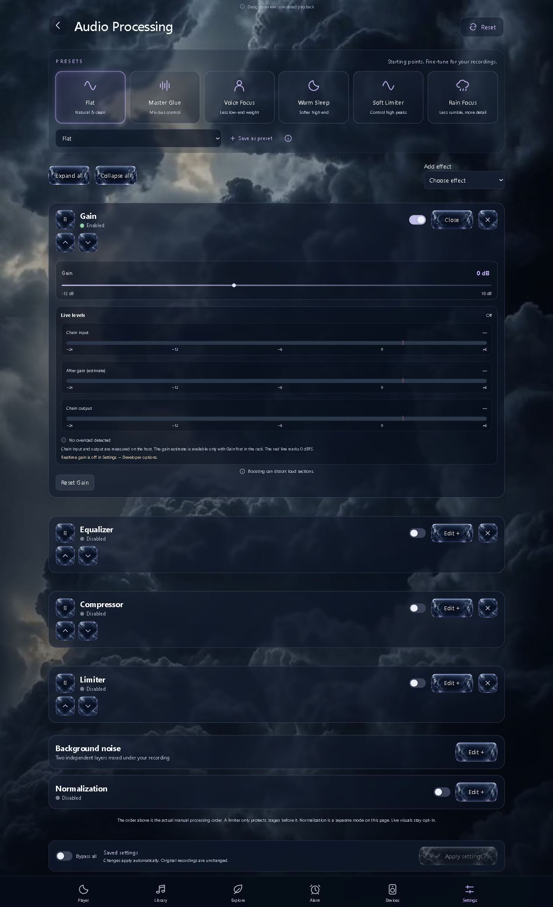

# Sleep Sounds

A local-first sleep-audio player with an Android app and a self-hosted Linux backend. Play your own recordings, control a nearby host from your phone, and experiment with profiles, effects and speaker routing.

**Early alpha:** intermittent audio stutters and output dropouts are still under investigation. Start with one output and test your setup before relying on it overnight. No recordings are included.

[Download the Android APK](https://github.com/JeremiahFD/Bluetooth-Sleep-Sounds/releases) · [Report a bug or suggest an idea](https://github.com/JeremiahFD/Bluetooth-Sleep-Sounds/issues) · [Roadmap](#roadmap) · [License](LICENSE)

## Screenshots

Actual interface captures using a simulated library; these are not evidence of hardware playback. The Linux effects rack shown below is more capable than Android's current gain/EQ implementation.





## Features

- Local playback, looping, seeking, next/previous and shuffle.
- Sleep timers, including a duration or stop-at time.
- Host selection and manual LAN/mesh connection settings; optional LAN discovery.
- Named profiles, a protected default None profile, remembered preferences, themes and fullscreen layout.
- Favorites, five-star ratings, file details, search, sorting, tags/categories and editable metadata.
- Host-local feedback, sound requests, track comments and replies.
- Android foreground playback host with a small LAN control server, or Android as a remote for Linux.
- Linux effects rack and experimental combined-output routing; Android supports gain attenuation and device-provided EQ.
- Local diagnostics and optional Linux health monitoring.

## Platform support

| Feature | Android APK | Linux backend |
| --- | --- | --- |
| Playback engine | Android MediaPlayer | mpv / FFmpeg |
| Local player and LAN controls | Implemented | Implemented |
| Profiles and library tools | Implemented | Implemented |
| Effects | Gain attenuation and native EQ; availability varies | Gain, EQ, dynamics, normalization, echo and experimental noise layers |
| Multiple simultaneous outputs | Not implemented | Experimental wired + Bluetooth combination |
| Alarms and mapped controllers | Not ported | Implemented; test on your hardware |
| Start after reboot | Open the app manually | Optional systemd user service |

The APK targets **Android 8.0 / API 26 or newer**. It is a universal Java/Kotlin APK without a device-specific native audio engine. Other phones, Android TV boxes, tablets and Android-compatible systems may work, but this release is not broadly hardware-certified. Android's codec and output capabilities differ by device. Linux runs the Python backend; **an APK does not run natively on ordinary Linux**. Other Linux distributions may need audio, Bluetooth, permission and service adjustments. A native Windows/macOS host is not included.

## Android quick start

1. Download the APK and SHA256SUMS from [Releases](https://github.com/JeremiahFD/Bluetooth-Sleep-Sounds/releases). This initial alpha is a debug-signed development build; preserve signing continuity for future in-place updates.
2. Install the APK. Android may ask you to allow installation from your browser or file manager.
3. Choose a role. For a local player, open **Device settings**, enable the local playback host, and choose **This device**. TV installations default to a local host; phones default to remote control.
4. For a remote, enter your own Linux/Android host address in connection settings, or use **Find nearby hosts**. No household addresses or recordings are embedded in this public build.
5. Add your own audio in Library. Choose Bluetooth/HDMI/wired output in Android system settings.

The startup picker appears when two distinct configured hosts answer identity checks. A single reachable host is selected automatically; manual selection remains available. Discovery depends on LAN multicast support and isn't guaranteed across isolated Wi-Fi networks. A browser can control an Android host at `http://<your-host-address>:8080/ui/` on the same trusted network.

Playback and the host run in an Android foreground service after leaving the app. Android may still stop an app after force-stop, reboot, standby or vendor power management; automatic boot recovery is not implemented. Open the app to start its host after an update/reboot. Do not assume an idle foreground service guarantees overnight availability.

## Linux quick start

Requirements: Python 3.11+, mpv, FFmpeg/ffprobe, BlueZ/bluetoothctl and, for the reviewed Bluetooth/service path, PipeWire + WirePlumber with a working user audio session. A Debian-family starting point is:

```sh
sudo apt install python3 python3-dbus python3-gi python3-tz mpv ffmpeg bluez pipewire pipewire-pulse wireplumber
cd frontend
npm ci
npm run build
cd ..
python3 server.py
```

The default server listens on loopback. For a trusted LAN, explicitly set the bind address and allowed Host values before starting:

```sh
export SLEEP_SOUNDS_BIND=0.0.0.0
export SLEEP_SOUNDS_HOSTS=localhost,127.0.0.1,<your-host-address>
python3 server.py
```

Replace the placeholder with your host's address. Open `http://<your-host-address>:8080/ui/` and import your own files. Data defaults to `~/.local/share/sleep-sounds`; use `SLEEP_SOUNDS_DATA` to choose another directory. On a headless systemd installation, follow [Linux setup](docs/PORTABILITY.md). Do not run disk-imaging tools or copy another person's Bluetooth configuration.

## Known issues and stutters

- Intermittent short stutters, repeating fragments, pops and Bluetooth dropouts have occurred. Some failures appeared only after hours of dual-output playback. A clean short test does not establish overnight reliability.
- Source-file defects/loop boundaries, decoder buffering, the audio graph, independent output clocks, Bluetooth links, Wi-Fi coexistence, USB resets and power stability can produce similar symptoms. There is no single proven root cause for every reported interruption.
- Wired-only playback and a single Bluetooth output have been more stable in some trials, but neither is guaranteed on other hardware. Start there before trying combined outputs.
- The experimental Linux combined helper uses on-demand branches and latency compensation. Its target sinks are configurable; it is not a general arbitrary-speaker synchronizer. Do not enable it without selecting your own sinks.
- The Android host avoids PipeWire, but has not completed a broad overnight/standby/Bluetooth test matrix. Native EQ may be unavailable on an output. Advanced Linux effects are not silently emulated.
- A browser preconnection starvation bug was fixed by using bounded immediate request workers and idle-header timeouts. Multicast discovery and phone-browser behavior still depend on the network/device.
- Profile data is local to each host, not a cloud account or cross-host sync. The interface is responsive but TV-remote navigation is not fully optimized.

When reporting a bug, include the app version, OS, output type, approximate time/track position, whether it affects one or every speaker, and recent changes such as seeking/effects/network reconnection. **Redact addresses, device identifiers, file paths, personal names and tokens before posting diagnostics.**

## Customize it, including with AI

Fork the repository and adapt the UI, themes, controls or backend for your own personal use. AI coding tools can help: point them at this README and [CONTRIBUTING.md](CONTRIBUTING.md), explain the target platform, and ask for a small tested change. Keep controls semantic, preserve user data/signing identity, and test real playback rather than assuming a successful build means good sound. Never give an AI tool private keys, passwords or unredacted diagnostics unnecessarily.

## Roadmap

These are possibilities, not delivery promises. **Suggestions and bug reports are welcome.**

### Next / reliability first

- Long-duration stutter regression tests and reproducible recordings after the actual output path.
- Stronger host discovery, identity handling, reconnect UX and clearer update/download flows.
- Saved output profiles, add/remove speakers and surviving-output behavior when one disconnects.
- Better clock-drift/sync controls; no guarantee of unlimited simultaneous Bluetooth speakers.
- Android host parity, TV-remote navigation and device compatibility testing.
- More consistent profile persistence, track deletion controls and editable library ratings/comments.

### Later

- Optional password-protected fallback Wi-Fi hotspot and simple Bluetooth play/pause/next controls.
- Controller default sound: last-played/current track, alongside an explicitly selected recording.
- Reverb/echo presets, additional effects and optional before/after meters with animations off by default.
- Investigate CamillaDSP as an optional advanced processing backend.
- Playlists, improved categories/tags, feedback moderation, profile pictures and optional local data export/import.
- Signed in-app update workflow with reliable versioning, optional/required release messaging and rollback guidance.

### Future / sound creation

- Mix rain, thunder, crickets or generated noise as independent layers.
- Route different tracks/layers to different outputs, with saved routing profiles.
- A sound-creation workspace: oscillators, colored noise, loops, effects and optional binaural-beat experiments.
- Explore a portable desktop host and interchangeable UI/theme layers. Android's system routing and each Bluetooth adapter's capabilities will impose practical limits.

### Suggested additions

- An overnight soak-test mode, redacted support bundle and exportable compatibility matrix.
- Accessible controls, localization, reduced-motion defaults and low-resource modes.
- Backup/restore with schema migrations, explicit local authentication and optional encrypted remote access.
- Gapless/loop-boundary tools, loudness analysis and a safe listening-level calibration workflow.

## Development

```sh
python -m unittest discover -s tests -v
cd frontend
npm ci
npm test
npm run build
```

To build Android, install JDK 17 and Android SDK 35, build the frontend, copy `frontend/dist/` into `android/app/src/main/assets/full-ui/`, then run:

```sh
cd android
./gradlew :app:assembleDebug :app:lintDebug
```

Windows uses `gradlew.bat`. Build outputs and SDK paths are ignored. No signing keys are supplied. New builds use your machine's debug signing identity unless you configure your own release signing; keep that key private and stable. The APK is distributed as a Release asset, not checked into Git. See [PORTABILITY.md](docs/PORTABILITY.md) and [THIRD_PARTY_NOTICES.md](THIRD_PARTY_NOTICES.md).

## Security and privacy

This is a trusted-LAN alpha, not a public internet service. Host/Origin checks and request tokens reduce accidental cross-origin control; they are not user authentication or transport encryption. Anyone with trusted-network access may be able to read/control the host. Do not port-forward it or expose it publicly. Discovery identifies a host; it is not cryptographic authentication. No audio files, household addresses, pairing databases, credentials, private project records or personal device logs are included in this repository/release.

## License and commercial use

[Sleep Sounds Personal Use License 1.0](LICENSE): personal, non-commercial use and personal customization are allowed. Commercial/profit-making use, commercial distribution, paid hosting, resale or incorporation into a paid product requires prior written permission. Contact the maintainer through a [GitHub issue](https://github.com/JeremiahFD/Bluetooth-Sleep-Sounds/issues) to arrange permission; do not post private contact or business details publicly.

This is **source-available, not OSI open source**. Third-party components retain their own licenses. Provided as-is, without a reliability or fitness guarantee.
